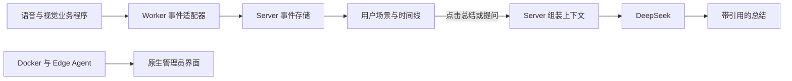

# EdgeStack 用户可视化工作台开发文档

版本：1.0  
日期：2026-11-15  
状态：首版已实施并完成最终页面功能回归。实测结果和已知边界见 [公开实施记录](docs/用户可视化工作台实施记录.md)；设计中的验收项不等于全部实机验收已通过。

## 一、产品目标与职责划分

### 1.1 用户工作台

用户登录后进入浅色 2.5D 设备空间，直观看到授权设备、业务任务、语音对话和摄像观察、当前模型、数据位置及可更换模型。用户端以日常语言组织信息。Docker 配置、部署报错、Agent 日志与资源诊断通过原生管理员页面查看。

### 1.2 已确认决策

| 项目 | 决定 |
| --- | --- |
| 视觉 | 原创设备插画、浅色固定等距视角、轻量动画 |
| 任务 | 一项业务对应一个任务，内部可有多个容器和模型 |
| 管理员 | 默认原生完整中文界面，保留 EdgeStack 品牌 |
| 总结内容 | 语音对话和摄像观察等设备与外界的交互 |
| 总结触发 | 用户点击；问题为空生成一般总结 |
| 数据可见性 | 按设备业务授权共享，每次查询和引用展开再次鉴权 |
| 模型更换 | 管理员发布兼容模型，用户确认后 Server 执行 |
| 首版接入 | 真实语音事件；视觉先完成接口与明确标注的演示 |

### 1.3 现有基础

当前具备设备接入、容器与挂载查询、Edge Stack 下发、日志读取和两个测试应用配方。新增工作包括独立用户界面、业务任务与模型目录、Worker 适配器、Server 事件与总结模块、受控模型更换。

Docker 启动日志和 HTTP 访问日志不能证明用户说了什么。语音最终转写、回复及视觉观察必须由业务程序明确输出。

## 二、界面与交互

### 2.1 布局和角色

| 区域 | 内容 |
| --- | --- |
| 左侧导航 | 品牌、设备空间、交互记录、模型与任务、账号 |
| 顶部 | 当前空间、设备筛选、时间范围、最近同步时间 |
| 中央 | 2.5D 设备空间 |
| 右侧 | 选中设备的详情面板 |
| 详情 | 近况、任务、当前模型、数据位置、交互时间线、总结与提问 |

管理员默认原生首页，普通用户默认设备空间。管理员通过显式用户预览入口查看新界面，不改变默认首页。新布局样式限于用户根节点；旧简洁偏好不决定角色分流，切换账号清理布局和内存状态。左侧始终有内容，窄屏改为图标和抽屉。

### 2.2 设备空间

每个真实设备对应一个稳定工位，名称、类型、连接情况、已启用业务和最后交互时间来自后端。单设备居中，多设备稳定排列。空位只表示可添加设备，不显示为假设备。点击聚焦并展开侧面板，返回保留筛选与位置。

采用分层 SVG、CSS transform 和状态过渡，不引入完整三维引擎。所有状态有文字和无障碍表达，支持减少动态效果。

| 动画 | 实际依据 |
| --- | --- |
| 设备亮起 | 连接及业务来源有效 |
| 语音气泡 | 新的最终转写或回复事件 |
| 观察提示 | 新视觉观察事件 |
| 数据流光点 | Server 实际收到新的业务记录 |
| 模型更换过渡 | 后端操作阶段变化 |
| 离线变灰 | 连接失效，当前状态待确认 |

running 容器不直接表现为正在对话；昨天事件的补传不播放为实时活动。生产环境不预置虚构对话和模型名。

### 2.3 任务与模型

“语音助手”可包含识别、对话、语音合成等多个服务；“家庭观察”可包含视频读取与识别服务。系统管理组件不计入用户任务。历史应用未登记时显示业务信息待登记。

模型按任务实际用途展示，名称、版本、格式、量化与运行后端来自发布目录及加载回执。没有对应用途时不显示空模型槽。

用户更换流程：查看兼容候选 → 生成预览 → 确认受影响任务与数据保留 → Server 执行 → 分别确认设备执行、服务启动与模型加载。没有替代包时给出明确说明。

### 2.4 数据位置

展示“设备 → 任务 → 业务数据 / 模型文件 / Server 交互记录”的关系。

| 数据 | 表达 |
| --- | --- |
| 端侧业务文件 | 保存在指定设备本地，关联实际任务与挂载 |
| 模型 | 位于固定镜像或专用只读模型目录 |
| Server 事件 | 已同步到管理中枢的交互文字 |
| 云分析 | 本次发送的文字记录范围，不表示永久云存储 |

目录用途由任务模板声明，Server 核对实际 Mounts。未知用途显示待登记，不默认暴露底层 Docker 路径或其他任务文件。

## 三、业务事件与模型契约

### 3.1 两条通道

### 3.2 事件类型与字段

| 类型 | 产生时机 |
| --- | --- |
| voice.user_utterance | 最终语音转写确认 |
| voice.assistant_reply | 最终回复完成，另记录播报阶段 |
| camera.observation | 视觉程序生成观察或变化文本 |

| 字段 | 含义 |
| --- | --- |
| schemaVersion | 协议版本 |
| eventId | 稳定且重试不变的标识 |
| sourceId / taskId | 登记的业务来源和任务 |
| type | 事件类别 |
| occurredAt | 实际发生时间，UTC |
| sessionId / sequence | 会话和顺序 |
| text | 最终文字 |
| replyToEventId | 对应用户事件 |
| provenance / phase | 来源程序、实际模型与生成/播报阶段 |

Server 依来源凭据绑定设备与任务，补充 receivedAt，不信任客户端任意声明归属。部分转写不反复进入正式时间线。生成回复与完成播报分别表达。视觉来源保留观察时段和不确定性，不把稀疏观察解释成持续监控。

### 3.3 Worker 适配器

语音程序在最终转写、最终回复和播报完成钩子写入专用 JSONL。适配器只读该目录，持久化游标与有界队列，批量上报，收到幂等确认后推进检查点。缺少钩子时补业务输出，禁止从通用日志推测对话。

适配器不挂载 Docker socket，不持有管理员令牌、EDGE_KEY 或云密钥。凭据仅可写指定来源。断网重传保留原事件时间，队列溢出、采集失败报告缺口。首版云端只接收文字，不上传原始音视频。

### 3.4 数据覆盖

| 状态 | 文案 |
| --- | --- |
| 来源未接入 | 语音交互/视觉观察尚未接入 |
| 来源完整且无记录 | 此时间段暂无交互记录 |
| 补传中或覆盖未知 | 部分时段尚未收到记录 |
| 已有事件 | 按发生时间、类型与会话查询 |

心跳只证明连接；只有检查点能证明采集覆盖。无记录时不编造“今天什么也没发生”。

### 3.5 模型目录和更换

模型、模型发布包和任务绑定分别建模。发布包包含模型 ID/版本/用途、固定镜像 digest、权重标识/位置、架构和硬件要求、兼容模板及模型槽、加载确认方式、用户更换许可和恢复方式。

管理员原生镜像列表是底层软件来源，用户只看到已验证发布包。首版用版本化目录和管理员校验/发布接口维护，不改造原生管理页。

更换只接受任务、已发布包、预览计划和幂等标识。Server 重新校验权限、任务归属、模板许可、模型发布与兼容性、在线情况和 revision。同一任务串行；预览过期或配置变化后重新确认。保留业务卷、端口和无关服务。

仅接管明确登记的独立任务；共享多设备部署先迁移。分别记录期望模型、实际镜像和实际加载模型，只有业务模型信息或可信回执能确认成功。

## 四、Server 与云分析

### 4.1 实现结构

Portainer Server 内新增 Go 业务模块，复用登录与授权。独立业务数据库位于 /data/edgestack/，保存任务、来源、事件、模型、总结和操作。普通用户只收到授权投影，不返回完整 Inspect、环境变量和任意文件。

原管理员接口保持 AdminAccess。受控更换复用内部部署服务，不保存管理员令牌或伪造身份。后端、前端与镜像版本一并锁定发布。

### 4.2 API

前缀 /api/edgestack。

| 方法与路径 | 用途 |
| --- | --- |
| GET /devices | 授权设备场景摘要 |
| GET /devices/{id} | 设备、任务、模型与数据位置 |
| GET /events | 时间线和覆盖情况 |
| GET /devices/{id}/event-sources | 来源接入情况 |
| POST /ingest/events | Worker 批量事件 |
| POST /ingest/status | 来源检查点与状态 |
| GET /tasks/{id}/models | 兼容候选 |
| POST /tasks/{id}/model-change-preview | 预览 |
| POST /tasks/{id}/model-changes | 确认执行 |
| GET /operations/{id} | 执行结果 |
| POST /summaries | 设备、时间、可空问题 |
| GET /summaries/{id} | 总结与引用 |

管理员目录与来源登记使用专用管理员接口。浏览器使用既有 Cookie；Worker 使用来源凭据。设备、任务及资源权限取交集，缓存与引用读取同样鉴权。

### 4.3 总结链路

点击 → 选择授权事件 → 冻结证据快照并分配 E1/E2 → 过滤凭据 → 发送问题与业务文字 → 校验 JSON/引用 → 返回总结。问题为空归纳话题、请求、答复与观察变化；有问题围绕证据回答。

无事件时本地返回接入/覆盖情况，不调用云端。按钮附近说明发送的设备、时间和文字类型。模型输出不控制设备或触发更换。

### 4.4 DeepSeek

Server 调用 https://api.deepseek.com/chat/completions，默认 deepseek-flash，关闭思考，JSON 输出，最多输出 2048 tokens。提示词要求 JSON 并提供结构例子。

| 配置 | 默认 |
| --- | --- |
| 触发 | 仅点击 |
| 云请求超时 | 60 秒 |
| 同一用户进行中任务 | 1 个 |
| 输入范围 | 最多 200 条、64 KiB，超限要求缩小范围 |
| 超时重试 | 不自动重复调用 |
| 返回 | 标题、总结、话题/观察、回答、引用、不确定项 |

Server 写入真实覆盖范围、记录数量与缺口，校验引用属于本次证据。空内容、无效 JSON、截断、鉴权、限流等明确失败，不因 HTTP 200 就显示成功。

API Key 通过 DEEPSEEK_API_KEY_FILE 只读注入；不写入本文件、前端、镜像、Git 或普通日志。凭据有效性以 Server 实测为准。新业务文字与总结默认保留 7 天，仅作用于新模块，不删除既有应用文件或数据卷。

官方参考：[调用说明](https://api-docs.deepseek.com/zh-cn/) · [接口参数](https://api-docs.deepseek.com/zh-cn/api/create-chat-completion/) · [JSON 输出](https://api-docs.deepseek.com/zh-cn/guides/json_mode/)。

## 五、开发与验收

### 5.1 阶段

| 阶段 | 交付 |
| --- | --- |
| 1 | 独立用户布局、设备空间、详情与明确标注的演示数据 |
| 2 | 业务 API、事件存储、权限、去重和覆盖 |
| 3 | 实际语音最终转写/回复/播报事件接入 |
| 4 | 实际事件的 Server→DeepSeek→页面总结闭环 |
| 5 | 兼容模型预览、更换、加载确认和恢复 |
| 6 | 管理员回归、设备测试、演示与文档、可回退发布包 |

视觉首版完成事件接口和演示，实际摄像程序独立验收。

### 5.2 用户体验

管理员原首页和侧栏可用；普通用户有完整导航和真实授权设备；单/多设备、选择返回、筛选、窄屏与减少动态效果可用；动画以真实新事件驱动；用户能找到任务、模型与数据位置。场景增量资源压缩后不超过 1 MB，24 节点目标浏览器至少 30 FPS。

### 5.3 事件与总结

实际麦克风输入并完成回复后核对文字、角色、顺序、播报状态；断网重传不重复；未接入/无事件/覆盖不完整分明；跨设备未授权查询与总结失败；空问题及有问题均有证据依据；引用可回溯；云端失败、格式错误和限流有反馈；前端和浏览器网络无云密钥。

### 5.4 模型

只允许发布兼容候选；拒绝任意镜像与配置；重复提交幂等；预览/revision/权限变化重新确认；卷与无关服务保留；区分服务启动与模型加载；先独立任务验证恢复。真实更换需至少两个经过 RK3588 验证的发布包，未验证镜像不冒充候选。

### 5.5 发布与回退

先隔离验证，再接真实设备。重新读取当前语音状态和配置，历史记录不代表实时。前后端及镜像清单统一锁定，新业务库独立路径备份。回退前后端时保留业务数据；设备上的模型变化按操作记录单独恢复。

## 六、已落地的开发接口与构建入口

实现与实测结果见 `docs/用户可视化工作台实施记录.md`，不以设计验收列表代替实际结果。

| 目录或文件 | 当前职责 |
| --- | --- |
| `portainer/app/edgestack/workspace.js`、`workspace.css` | 用户布局、设备空间、关系图、交互记录、总结与受控模型操作 |
| `portainer/api/edgestack/` | 独立业务库、授权、事件、模型状态机、总结及脱敏 |
| `portainer/api/http/handler/edgestackbusiness/` | 原认证授权接入、Edge Stack 调度与实际容器挂载核验 |
| `worker/business-events/` | JSONL 钩子、持久队列、语音适配、实际模型观察与录音测试页 |
| `deploy/server/Dockerfile.business`、`compose.business.yaml` | 固定基线运行镜像与只读私密配置挂载 |
| `scripts/build-business-server.sh`、`scripts/build-ui.py` | 后端运行上下文和绑定不可变镜像的前端清单 |
| `demo/conference/business-fixture.js` | 仅离线使用的明确模拟数据与操作 |

### 6.1 时间线与运行状态

`GET /events` 必须带授权设备的 `deviceId`，支持 `from`、`to`、`type`（单值或逗号分隔）与 `sessionId`。类型、会话过滤发生在权限和时间范围校验之后、分页之前；游标只在匹配集合中解析。`coverage.eventCount` 是窗口内记录总数，`filteredCount` 表达筛选结果数量。全部设备视图逐授权设备查询并合并。

任务登记 `state` 与实时 `runtimeState` 分开。`runtimeState=running` 必须来自唯一运行容器的真实查询；它仅表示任务实例进程运行，不表示已加载所有模型或正在和人交互。`runtimeObservedAt` 给出核验时间。挂载和模型加载也各自保留核验状态与时间。

### 6.2 发布、追溯和凭据

新增管理员专用 `POST /admin/models/{id}/publication`，正文为 `{"published":true}` 或 `{"published":false}`。不可变包体保持锁定；撤销后新预览和原预览的确认均不能执行。旧启动文件不会重新激活已撤销的包。已经实际运行的模型仍如实记录加载回执，撤销发布不暗中停止设备。

预览与操作保存 `previousPackageId`，便于追溯先前模型。失败恢复通过选择此前已发布包、重新预览和明确确认执行；不使用旧管理员令牌绕过授权。

来源令牌采用 `es_ingest_` 前缀和足够的随机内容，Server 只存 SHA-256；来源、设备、任务和能力必须同时匹配。DeepSeek、业务摄取和语音上游使用独立凭据，均不进入前端或演示。

### 6.3 实际语音接入

真实录音入口为 `/api/edgestack/tasks/{taskId}/voice-test`。先检查 ASR/TTS 真实健康状态，用户点击后才申请麦克风；结束或取消关闭录音。当前入口提供识别与回声合成，用于接入验证，不假设已经部署对话大模型。

现有镜像的语音钩子通过 ASGI 适配层接入，原程序文件不改写。RK3588 SDK 使用经过来源、只读属性和芯片标识校验的真实设备树路径；短音频结果按 typed 返回值兼容，保留识别语言，不解析或执行字符串。

JSONL 读取游标和未确认事件采用独立持久 SQLite 队列。生产者历史完整性没有证明时，即使适配器已连接也保持覆盖不完整。首版测试完成后的具体版本、哈希及剩余边界见实施记录。
